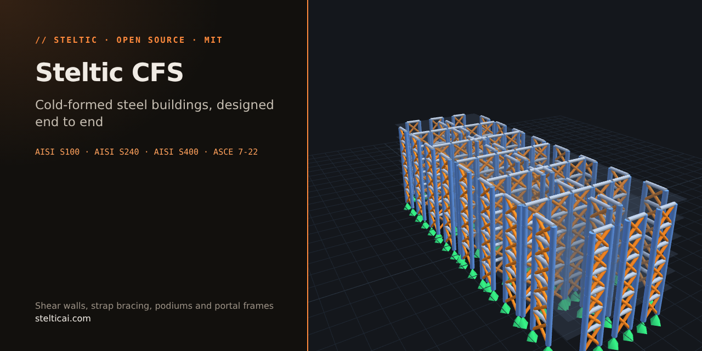

# Steltic CFS

[](LICENSE)
[](https://github.com/Steltic/steltic_cfs/releases)
[](pyproject.toml)



Free, open-source AI agent that designs cold-formed steel buildings to **AISI S100-16 (R2020) w/S2, S3**,
**S240-20** and **S400-20** with **ASCE 7-22** loads, on your own machine: wall-path buildings (WSP, steel-sheet,
strap-braced and gypsum shear walls, podium and mixed systems, up to 8 storeys) and portal-frame buildings.
Paste a design brief and get an OpenSees model, a calculation report and an interactive 3D viewer. Bring your
own LLM API key (your API base URL and key are held in memory only, never written to disk).

- **Easiest start:** [Steltic Hub](https://github.com/Steltic/steltic_hub) installs this and the other modules
  in one window.
- **See the output first:** 25 worked buildings with reports and 3D models at [stelticai.com](https://stelticai.com).
- **Video:** [Steltic Hub installation](https://www.youtube.com/watch?v=LNHzOBkjicM).
- **Indian Standards edition:** [steltic_CFS_india](https://github.com/Steltic/steltic_CFS_india).

```
browser ──▶ FastAPI app (localhost) ──▶ your LLM (key in app memory, never stored)
                 │  parses tool calls
                 ▼
           sandbox executor (run_python only) — Docker when available
                 │
           steel engine + OpenSees ─▶ report.html + viewer_3d.html
```

> **Not for construction.** Every output is produced by your own AI model, may be incomplete or
> incorrect, and must be independently checked and sealed by a licensed professional engineer before
> any use for design, construction, or permitting. See [DISCLAIMER.md](DISCLAIMER.md).

## Install & run

Most people should start with [Steltic Hub](https://github.com/Steltic/steltic_hub), which clones and installs
this module for you. To run this module on its own, install it from GitHub. It needs **Python 3.10–3.12**
(openseespy, the analysis engine, ships compiled binaries for those versions only); 3.12 is recommended.

**Windows (PowerShell)**

```powershell
git clone https://github.com/Steltic/steltic_cfs
cd steltic_cfs
py -3.12 -m venv .venv
.venv\Scripts\Activate.ps1
pip install -e .
steltic-cfs                  # starts on http://127.0.0.1:8000 and opens your browser
```

**macOS / Linux**

```bash
git clone https://github.com/Steltic/steltic_cfs
cd steltic_cfs
python3.12 -m venv .venv
source .venv/bin/activate
pip install -e .
steltic-cfs                  # starts on http://127.0.0.1:8000 and opens your browser
```

The install brings the full engine (openseespy, numpy, scipy, matplotlib, about 400 MB), so designs run without
Docker. To run with a `.env` file of settings, use `./run_local.sh` or `.\run_local.ps1` instead of `steltic-cfs`.

**Update:** in the repo folder, `git pull`, then `pip install -e .` again (needed only when `pyproject.toml`
changed, harmless otherwise).

First run: open **Settings**, enter your provider's **API base URL** (any OpenAI-compatible
endpoint — OpenRouter, vLLM, Together, Fireworks, OpenAI, Anthropic…), your **API key**, and a
**model** id. Then paste a brief (stories, bays & spacings, loads, seismic, system) — or pick one of
the 25 built-in example briefs (numbered Ex1-Ex30; Ex20-24 rack briefs are descoped -- `EXAMPLE_BRIEFS` in steltic/main.py is the source of truth) — and click **Design building**.

Offline smoke test: set Model to `MOCK` — it drives the whole pipeline (sandbox, engine, OpenSees,
report) with no LLM.

**Windows note:** if starting fails with *"Application Control policy has blocked this file"* or
*"os error 4551"*, Windows **Smart App Control** is blocking an unsigned Python. Use the signed python.org
build and recreate the environment:

```powershell
winget install Python.Python.3.12       # then open a new terminal in the repo folder
Remove-Item -Recurse -Force .venv
py -3.12 -m venv .venv
.venv\Scripts\Activate.ps1
pip install -e .
```

## Sandbox

The agent's Python only ever executes in a sandbox. `EXECUTOR` (env / `.env`) picks the mode:

| value        | isolation | notes |
|--------------|-----------|-------|
| `auto`       | Docker if available, else subprocess | default |
| `docker`     | container per run: no network, read-only fs, non-root, cpu/mem caps | build once: `./sandbox_image/build.sh` |
| `subprocess` | none (child process with rlimits) | needs `pip install openseespy numpy scipy matplotlib`; fine for local single-user use |

Steltic binds to 127.0.0.1 and has **no authentication** — don't expose the port. Designs are saved
under your OS user-data dir (e.g. `%LOCALAPPDATA%\Steltic`, `~/.local/share/Steltic`); override
with `DATA_DIR`.

## Engineering-standards, OpenSees & design-examples RAG (highly recommended)

Steltic was validated with RAG
vector databases of AISI S100-16(R2020)+S2/S3, S240-20 and S400-20, an examples database of
validated OpenSees models, and two databases of the OpenSees documentation. The specifications and design examples ground the LLM in
the current procedures; the OpenSees databases help it build the model — and when OpenSees throws
errors, resolve them. Steltic's performance has been validated **with** these databases and will
likely reduce without them.

For copyright reasons the vector databases of the AISI standards are **not** open-sourced in
this project. The OpenSees databases are freely downloadable from the
[Steltic v0.1.1 release](https://github.com/Steltic/steltic/releases/tag/v0.1.1) (shared with the AISC agent) as portable `.jsonl.gz` dumps
(pre-embedded; see [rag_v2/README.md](rag_v2/README.md) for loading them into your own Qdrant):
`cfs_design_examples` (original worked Q&A for the CFS scope; being authored),
`opensees_buildings_3d` (40 validated 3D building models), `opensees_building_templates`, and the
two OpenSees documentation sets.

Two options:

1. **None (default — not recommended).** Leave `RAG_API_URL` empty — the agent relies on its own
   cited AISI/CFS knowledge. Good models do respectably; grounded runs are better.
2. **Bring your own server.** Run any server exposing the small API described in
   [rag_v2/README.md](rag_v2/README.md): load the downloadable OpenSees databases, and build the
   standards collections from your own licensed copies with the `rag_v2/` chunking + ingestion
   starter kit. Then put the connection in the environment (or a `.env` next to where you launch):
   `RAG_API_URL=http://your-server:8080/query` and, if your server enforces one, `RAG_API_TOKEN=...`.

## A tool call the model never finished

A provider behind OpenRouter validates the whole conversation on every request. If a turn is cut off
in the middle of a tool call's arguments (`{` and nothing more), a provider such as Together refuses
the *next* request with `400 Invalid JSON in tool call arguments` — a 400 the retry net does not
retry, so the run ended, and the cut-off turn saved in `conversation.json` broke every *Continue*
after it. The agent now keeps every tool call in the history parseable (`{}` stands in for
arguments that did not parse), never runs such a call, answers it with an error that asks the model
to repeat it with complete arguments, and heals a conversation saved by an older version when it is
resumed. `tests/test_tool_call_healing.py`.

## Repo map

`steltic/` FastAPI app + agent loop + sandbox executors · `steel_engine/` OpenSees modelling,
design pipeline, consistency checks, report + 3D viewer · `contract/` the agent's working contract
and references · `frontend/` vanilla JS UI · `sandbox_image/` Docker sandbox image ·
`test_buildings/` the 25 CFS example briefs with assessment rubric · `rag_v2/`, `rag_update/`
build-your-own-RAG starter kit.

## License

MIT — see [LICENSE](LICENSE), [NOTICE](NOTICE) (third-party data notes) and
[DISCLAIMER.md](DISCLAIMER.md) (engineering disclaimer; also shown in-app at `/terms`).
